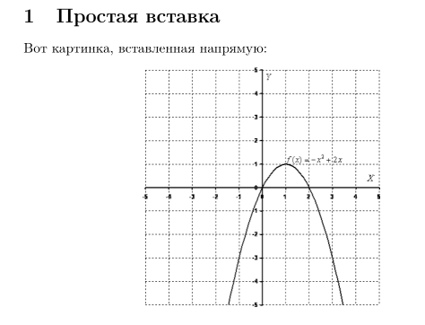
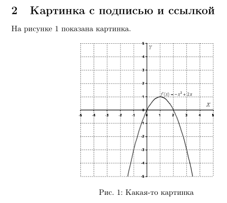
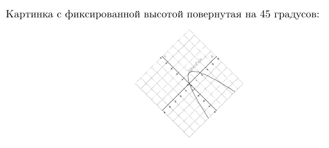

# Цель работы

Изучение возможностей LaTeX по включению графических изображений, управлению их размерами и расположением, а также созданию перекрёстных ссылок на рисунки.

---

# Задание

Освоить пакет `graphicx`, научиться вставлять изображения, изменять их размеры и поворот, создавать плавающие объекты с подписями и ссылками.

---

# Теоретическое введение

Для работы с графикой в LaTeX используется пакет `graphicx`, который предоставляет команду `\includegraphics`. Эта команда позволяет вставлять изображения в форматах PNG, JPG, PDF и EPS.

Основные параметры команды `\includegraphics`:
- `width` — ширина изображения (может задаваться относительно `\textwidth` или `\linewidth`);
- `height` — высота изображения;
- `angle` — угол поворота;
- `scale` — масштаб.

Для создания «плавающих» объектов (floats), которые LaTeX автоматически размещает на странице, используется окружение `figure`. Внутри него указываются команда вставки, подпись (`\caption`) и метка (`\label`) для перекрёстных ссылок.

Перекрёстные ссылки создаются командой `\ref`, которая подставляет номер объекта, связанного с меткой.

---

# Выполнение лабораторной работы

## Шаг 1. Подключение пакета graphicx

Для работы с изображениями был подключён пакет `graphicx`, который предоставляет команду `\includegraphics`.

---

## Шаг 2. Прямая вставка изображения

Изображение было вставлено напрямую в текст с помощью окружения center для горизонтального центрирования. Ширина задана как половина ширины текста (`0.5\textwidth`).Изображение было вставлено напрямую в текст с помощью окружения center для горизонтального центрирования. Ширина задана как половина ширины текста (`0.5\textwidth`).

```latex
section{Простая вставка}
Вот картинка, вставленная напрямую:
\begin{center}
    \includegraphics[width=0.5\textwidth]{1.png}
\end{center}
```


---

## Шаг 3. Создание плавающего объекта с подписью и ссылкой

Изображение было помещено в окружение figure, которое позволяет LaTeX автоматически размещать объект на странице. Добавлены подпись (`\caption`) и метка (`\label`) для перекрёстной ссылки. В тексте использована команда `\ref` для ссылки на рисунок.

```latex
\section{Плавающая картинка}
На рисунке~\ref{fig:my_pic} показана картинка.
\begin{figure}[ht]
    \centering
    \includegraphics[width=0.5\textwidth]{1.png}
    \caption{Какая-то картинка}
    \label{fig:my_pic}
\end{figure}
```


---

## Шаг 4. Изменение размеров и поворот изображения

Были опробованы параметры angle (поворот на 45 градусов) и width (уменьшение ширины до 30% от ширины текста).

```latex
\section{Размеры}
Картинка с фиксированной шириной, повернутая на 45 градусов:
\begin{center}
    \includegraphics[angle=45, width=0.3\textwidth]{1.png}
\end{center}
```


---

# Выводы

В ходе лабораторной работы были освоены основные приёмы включения графики в документы LaTeX. Научился вставлять изображения с помощью пакета graphicx, изменять их размеры и угол поворота, создавать плавающие объекты с подписями и перекрёстными ссылками.

---

# Список литературы{.unnumbered}

::: {#refs}
:::
